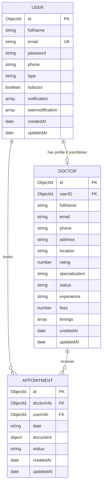
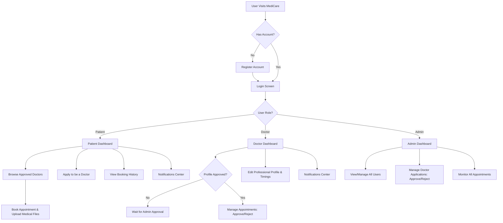

# MediCare

MediCare is a state-of-the-art healthcare consultation and appointment booking web application. It connects patients with verified medical practitioners, enabling smooth scheduling, professional profile management, and document uploads.

- **Vercel Frontend URL:** [https://medi-care-gamma-five.vercel.app/](https://medi-care-gamma-five.vercel.app/)
- **Render Backend URL:** [https://medicare-uz8a.onrender.com](https://medicare-uz8a.onrender.com)

---

## 1. Problem Statement
Finding and scheduling appointments with certified doctors is often complex, fragmented, and time-consuming. 
* **For Patients:** Discovering reliable specialists near their location, reviewing their experience/consultation fees, and sharing medical history or previous diagnostic reports before the appointment is hard.
* **For Doctors:** Practitioners struggle to manage their schedules, handle incoming requests, configure availability hours, and securely access medical files shared by patients.
* **For Admins:** There is a lack of centralized vetting systems to review new practitioner registrations to prevent unverified profiles from offering services.

---

## 2. Solution
**MediCare** solves these issues with a cohesive, three-tiered system (Patients, Doctors, and Admins):
* **Patients:** Can browse verified specialists, see their ratings, locations, and fees, upload diagnostic reports, request appointments, and view booking history.
* **Doctors:** Benefit from an intuitive schedule manager where they can approve/reject appointments, view patient uploads, and edit their professional profiles.
* **Admins:** Have a unified control panel to review and approve doctor applications, manage registered users, and audit active appointments.

---

## 3. Entity-Relationship (ER) Diagram
The application is built on top of MongoDB using the following relational structure:

---

## 4. User Flow Diagram
The flowchart below details the core user journeys for Patients, Doctors, and Admins:

---

## 5. Technology Stack
* **Frontend:** React, Vite, Bootstrap (React-Bootstrap), Ant Design (Icons, TimePicker, Toast notifications), Axios
* **Backend:** Node.js, Express, Mongoose, JWT (Authentication), Multer (File uploads), Cors
* **Database:** MongoDB Atlas
* **Hosting:** Vercel (Frontend), Render (Backend)
